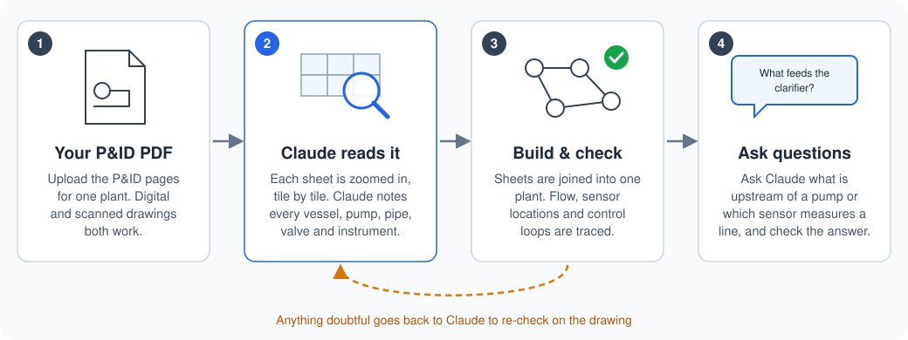

# P&ID to Knowledge Graph

By Scott Duncan. Reach me on [LinkedIn](https://www.linkedin.com/in/s-r-duncan/) or at [scottduncanai.com](https://scottduncanai.com/).

**Turn P&ID drawings into a process knowledge graph that an LLM can reason over.**

`pid-to-kg` is a [Claude skill](https://code.claude.com/docs/en/skills) that reads piping and instrumentation diagrams (P&IDs) and PFDs from PDF and builds a knowledge graph of the process. The PDFs can be digital (exported from CAD) or scanned. The graph captures:

- **Process flow:** what is upstream and downstream of every tank, pump, valve and pipe segment.
- **Measurement:** which instrument measures which variable, and exactly where it sits in the flow.
- **Control:** control loops from sensor through controller to final element, including I/P relays, cascades, interlocks and VFD drives.

The output is meant to be one layer of a chemical-manufacturing **context layer**. An LLM application can query it to answer questions such as "what feeds this clarifier?", "which transmitters sit downstream of P-101?" or "what does FIC-0502 manipulate?" from the drawings themselves.

## Quick start

No programming is needed. You need [Claude Code](https://code.claude.com/docs/en/overview) (the desktop app or the terminal version) and [Python](https://www.python.org/downloads/) 3.10 or newer. Python 3.12 is the best choice: on 3.13 and later the skill still works, but without the text-recognition (OCR) cross-check and automatic page orientation.

**1. Download the skill.** On this page, click the green **Code** button, then **Download ZIP**. Unzip the file.

**2. Install it.** In the unzipped folder, open `skills` and copy the `pid-to-kg` folder into your personal Claude skills folder:

| System | Skills folder |
|---|---|
| Windows | `C:\Users\<your user name>\.claude\skills\` |
| macOS | `/Users/<your user name>/.claude/skills/` |

If the `skills` folder doesn't exist yet, create it. The `.claude` folder is hidden by default: in Windows File Explorer use **View → Show → Hidden items**, and in macOS Finder press **Cmd + Shift + .** to show it.

**3. Add your P&IDs.** Make a new folder for the project and put your P&ID PDF in it. Open that folder in Claude Code: in the desktop app, start a new Code session and choose the folder.

No P&IDs at hand? My [public chemical manufacturing datasets](https://github.com/ScottDuncanAI/public-chemical-manufacturing-datasets#pids) repo lists public P&ID sets from real permitted facilities, with the page numbers where the drawings are. Both digital and scanned sets are included.

**4. Ask Claude to convert them.** For example:

> Convert `haile.pdf` into a knowledge graph. The P&IDs are on pages 47–60.

The skill loads by itself; there is no need to name it. The first time, Claude installs the Python packages it needs, and it asks your permission before running commands. It then reads every sheet in detail, so a large drawing set takes a while. Claude may ask a question along the way, such as which revision to use when a PDF holds two versions of the same drawing. When it is done, it reports what it found and what remains uncertain.

**5. Check the graph by asking questions.** The best test is to ask about things you can verify on the drawings:

> Name all the equipment upstream of the clarifier.
>
> What sensor measures the flow into TK-101, and where exactly is it?
>
> What does FIC-0502 control, and what valve does it move?

The results are saved in `work/<plant name>/kg/` inside your project folder. `summary.md` is a readable overview of the whole plant, and `qa_report.md` lists anything Claude could not confirm.

## How it works



**Claude reads the drawings; Python scripts do everything else.** Recognising symbols and tracing lines on real drawings (rotated sheets, small text, low-resolution scans, greyed-out existing plant) needs visual reasoning, so that part is Claude's. Preparing the pages, joining the sheets, tracing loops, checking and storing the result is routine work, so it is done by tested Python scripts that give the same answer every time.

1. **Prepare the pages.** A script first works out what kind of PDF it has. Digital drawings are rendered straight from the vector data. Scanned drawings are cleaned up and enlarged. Many CAD exports have no searchable text at all, because every label is drawn as outlines, so the skill never relies on a text layer. Each sheet is turned the right way up, and the resolution is chosen from the size of its text. The sheet is then cut into overlapping tiles so that even small tags are legible.
2. **Claude reads each sheet.** Working tile by tile, Claude records every piece of equipment, pipe run, valve, instrument, signal line and off-page connector, along with where on the sheet it found each one and how confident it is. Each sheet is saved to its own file before the next one starts. Text recognition (OCR) runs alongside as a cross-check, to catch tags Claude may have missed.
3. **Build and check the graph.** The scripts join the sheets into one plant by matching tags and off-page connectors. They split each pipe into segments between its valves and fittings, so every instrument has an exact position in the flow. They then trace upstream and downstream connections, work out what each instrument measures, and assemble control loops from the instrument tags (per ISA-5.1) and the signal lines. A QA report lists anything doubtful: a sensor with no location, an off-page connector with no partner, a tag OCR saw but Claude did not. Claude re-checks each one on the drawing and rebuilds until the report is clean.
4. **Ask questions.** The graph is saved in formats that suit different uses: a readable summary for an LLM's context, a JSON file any tool can read, and a small database file for precise queries. Nothing needs a server.

Every item in the graph records the sheet it came from, so any answer can be traced back to the drawing. Equipment and instruments also carry the closest [DEXPI](https://dexpi.org) class, the industry standard for exchanging P&ID data.

## Outputs

| File | What it is |
|---|---|
| `summary.md` | A readable overview of the plant: equipment-level flow, equipment, instruments with their locations, control loops and off-page links. This is the file to give an LLM as context. |
| `qa_report.md` | Errors, warnings and notes, each pointing to the part of the drawing to re-check |
| `graph.json` | The complete graph (schema: [`graph.schema.json`](skills/pid-to-kg/references/schema/graph.schema.json)) |
| `graph.duckdb` | The same graph as a [DuckDB](https://duckdb.org) database file, for SQL queries, including recursive upstream and downstream searches |

For larger projects, the graph can also be exported to Neo4j or to GraphML (for yEd, Gephi or NetworkX). Ask Claude to do it.

The node and edge types are described in [`references/ontology.md`](skills/pid-to-kg/references/ontology.md). [`examples/`](examples/README.md) holds finished graphs for three real plants: two digital drawing sets and one scanned set.

## Repository layout

```
skills/pid-to-kg/
  SKILL.md                    workflow Claude follows
  references/                 extraction procedure, ISA-5.1 guide, symbol guide, ontology, JSON schemas
  scripts/                    probe, render, hints, build, query, export, eval, crop
  scripts/pidkg/              library: models, ISA parsing, builder, loops, QA, storage, summary
docs/                         README diagram
tests/                        pytest suite with a synthetic two-sheet plant and synthetic PDFs
examples/                     graphs, extractions and spot-check files for three test plants (source PDFs not redistributed)
```

## Limitations

- **Extraction quality depends on legibility.** Low-resolution scans lose small text. Unreadable items are recorded as such, never guessed.
- **Loops come from ISA tag numbers and drawn signal lines.** Logic that lives only in control narratives or cause-and-effect charts is not on the P&ID and is not captured.
- **Line direction is taken from arrows and equipment logic.** Edges whose direction had to be inferred are marked `flow_direction: inferred`.
- **The DEXPI mapping is informative.** It is not a certified DEXPI export.

## Development

```bash
pip install -e ".[dev]"
pytest
python skills/pid-to-kg/scripts/build_kg.py --write-schemas   # after changing pidkg/models.py
```

## Disclaimer

The graph is machine-extracted from drawings. It must be reviewed by a qualified engineer before it is used for design, operations, management of change, or safety studies such as HAZOP or LOPA.

## License

MIT. See [LICENSE](LICENSE).
